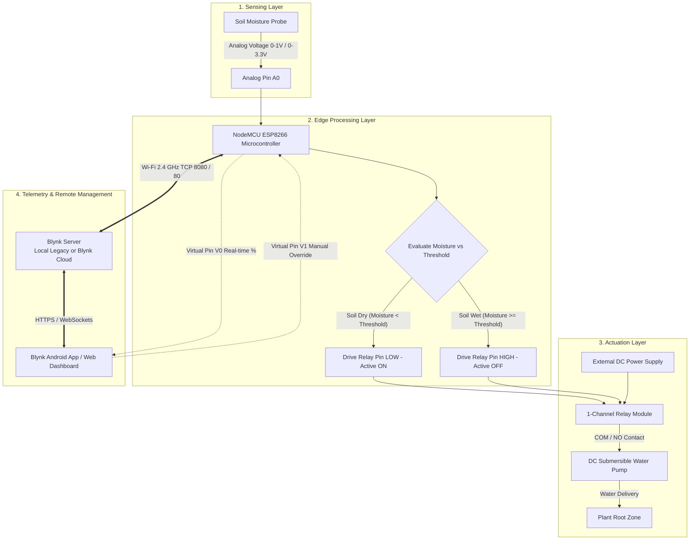

# IoT-Based Smart Plant Irrigation System 🌿💧

[](https://www.espressif.com/)
[](https://www.arduino.cc/)
[](https://blynk.io/)
[](http://www.mnnit.ac.in/)
[](https://iotproject-nit.vercel.app)
[](LICENSE)

An intelligent, low-cost Internet of Things (IoT) automated irrigation system developed at **Motilal Nehru National Institute of Technology (MNNIT) Allahabad**. The system measures real-time soil moisture using capacitive/resistive soil probe sensors, performs edge-level decision making via a **NodeMCU ESP8266**, and automatically actuates a DC water pump through an optically isolated active-LOW relay module. 

The architecture supports both **Self-Hosted Blynk Legacy Local Infrastructure** (zero-subscription, private local LAN deployment) and **Blynk IoT Cloud** for real-time mobile telemetry and remote manual override.

---

## 📑 Table of Contents

- [System Overview](#-system-overview)
- [Key Features](#-key-features)
- [System Architecture](#-system-architecture)
- [Hardware Specifications & Bill of Materials](#-hardware-specifications--bill-of-materials)
- [Circuit Pinout & Wiring](#-circuit-pinout--wiring)
- [Firmware & Control Logic](#-firmware--control-logic)
- [Blynk Infrastructure & Mobile Dashboard](#-blynk-infrastructure--mobile-dashboard)
- [Installation & Flashing Guide](#-installation--flashing-guide)
- [Soil Calibration & Testing Procedure](#-soil-calibration--testing-procedure)
- [Repository Structure](#-repository-structure)
- [Implementation Status & Roadmap](#-implementation-status--roadmap)
- [Project Team & Acknowledgments](#-project-team--acknowledgments)
- [Documentation & References](#-documentation--references)

---

## 🌟 System Overview

Irrigation is most effective when water is delivered based on actual soil moisture dynamics at the root zone rather than fixed timers. Conventional timers water regardless of soil saturation, leading to water wastage, nutrient runoff, and root rot, while manual checking often allows soil to dry out beyond wilting points.

This prototype provides an automated closed-loop solution:
1. **Continuous Sensing:** Measures root-zone soil dielectric conductivity/resistance via analog pin `A0`.
2. **Edge Computing:** Samples data at 1 Hz intervals, maps raw 10-bit analog-to-digital converter (ADC) counts into calibrated moisture percentages (0%–100%), and executes threshold rules locally without needing cloud roundtrips.
3. **Actuation:** Controls a 1-channel active-LOW relay that switches a DC submersible water pump connected to an independent external power supply.
4. **Cloud & Local LAN Telemetry:** Transmits real-time moisture data to a mobile dashboard and allows users to manually trigger or override the pump.

---

## ✨ Key Features

- **Automated Root-Zone Irrigation:** Automatic pump switching based on configurable moisture thresholds.
- **Edge-Level Autonomy:** Control decisions run directly on the ESP8266 microcontroller; watering logic functions reliably even if Wi-Fi or internet connection is lost.
- **Dual IoT Backend Compatibility:**
  - **Self-Hosted Blynk Legacy:** Powered by community-maintained Java server (`Peterkn2001/blynk-server`) on private network ports (`9443` HTTPS admin, `8080` TCP hardware).
  - **Blynk 2.0 Cloud Ready:** Native support for template IDs and cloud credentials.
- **Remote Mobile Dashboard:** Real-time percentage gauge visualization (`V0`) and manual pump toggle override switch (`V1`).
- **Electrical Safety & Isolation:** Separated power domains between low-voltage 3.3V/5V logic and inductive motor current, preventing microcontroller resets, brownouts, and back-EMF voltage spikes.


---

## 🏗 System Architecture

The system operates across four coordinated layers: **Sensing**, **Edge Processing**, **Actuation**, and **IoT Communication**.



---

## 🔩 Hardware Specifications & Bill of Materials

| Component | Quantity | Key Specifications / Model | Role in System |
| :--- | :---: | :--- | :--- |
| **NodeMCU ESP8266** | 1 | ESP-12E module, Tensilica 32-bit LX106, 80/160 MHz, 2.4 GHz Wi-Fi 802.11 b/g/n, 1x 10-bit ADC (`A0`) | Primary edge microcontroller and network gateway |
| **Soil Moisture Sensor** | 1 | Resistive/Capacitive soil probe module with onboard LM393 comparator (AO & DO pins) | Root-zone soil moisture sensing |
| **Relay Module** | 1 | 1-Channel 5V Relay with Optocoupler isolation (Active-LOW, rated 10A 250VAC / 10A 30VDC) | High-current switching for the DC motor pump |
| **Submersible Water Pump** | 1 | Mini DC submersible water pump (3V–6V or 12V DC, 100–220 L/H discharge) | Supplies water from reservoir to plant container |
| **External DC Power Supply**| 1 | 5V / 12V DC Adapter or Battery pack (matched to pump motor rating) | Independent motor power to eliminate electrical brownout |
| **USB Power Cable / Supply**| 1 | Standard 5V 1A Micro-USB adapter | Powers the NodeMCU logic board |
| **Breadboard & Wires** | 1 set| Solderless breadboard, Male-to-Male and Male-to-Female jumper wires | Prototyping interconnections |
| **Flexible Water Tubing** | 1 m | 6 mm / 8 mm silicone hose | Directs water flow from pump output to soil |

---

## 🔌 Circuit Pinout & Wiring

### 1. Interconnection Table

| Sensor / Module Pin | NodeMCU Pin | Function / Description |
| :--- | :--- | :--- |
| **Soil Sensor AO** | **A0** (ADC0) | Analog moisture voltage input (0–1023 ADC range) |
| **Soil Sensor VCC**| **3V3** or **VIN (5V)** | Sensor operating power supply |
| **Soil Sensor GND**| **GND** | System common ground |
| **Relay IN** | **D4** *(or **D3**)* | Digital output signal to control relay (Active-LOW: LOW=ON, HIGH=OFF) |
| **Relay VCC** | **VIN (5V)** | Relay coil power (recommended 5V) |
| **Relay GND** | **GND** | System common ground |

### 2. High-Current Pump Circuit
> [!WARNING]
> **Power Isolation Rule:** Never power the DC water pump directly from the NodeMCU's `3V3` or `VIN` pins. Electric motors draw substantial inductive inrush currents that can reset the ESP8266 or permanently damage its voltage regulator.

- **External DC Supply Positive (+)** $\rightarrow$ **Relay COM (Common)**
- **Relay NO (Normally Open)** $\rightarrow$ **Pump Positive (+)**
- **External DC Supply Negative (-)** $\rightarrow$ **Pump Negative (-)**

### 3. Hardware Reference Diagrams

| Hardware Setup | Circuit Diagram |
| :---: | :---: |
|  |  |

| Irrigation System Reference |
| :---: |
|  |

---

## 💻 Firmware & Control Logic

The firmware is located at [`Firmware/PlantWatering_NodeMCU.ino`](file:///Users/anujparihar/Downloads/IoT-Smart-Irrigation-System-main/IoT-Smart-Irrigation-System/Firmware/PlantWatering_NodeMCU.ino) and implemented in Arduino C++.

### Moisture Mapping & Normalization Formula
The ESP8266 ADC measures a 10-bit value ranging from `0` to `1023`. Because soil resistance is inversely proportional to water content, dry soil yields higher voltage/ADC counts, while wet soil yields lower values. The firmware normalizes this using linear interpolation:

$$\text{Moisture (\%)} = \left(\frac{\text{ADC}_{\text{dry}} - \text{ADC}_{\text{raw}}}{\text{ADC}_{\text{dry}} - \text{ADC}_{\text{wet}}}\right) \times 100$$

Where:
- $\text{ADC}_{\text{dry}} = 1023$ (Air / Dry soil baseline)
- $\text{ADC}_{\text{wet}} = 450$ (Saturated wet soil baseline)

### Virtual Pin Assignments
- **`V0` (Output Telemetry):** Reports mapped soil moisture percentage (`0%–100%`) to the dashboard gauge widget at 1 Hz intervals.
- **`V1` (Input Control):** Push button or switch widget allowing manual pump override:
  - `state == 1` $\rightarrow$ `pumpOn()` (Drives relay pin `LOW`)
  - `state == 0` $\rightarrow$ `pumpOff()` (Drives relay pin `HIGH`)

### Core Firmware Snippet
```cpp
// Pump control logic (Active-LOW relay)
void pumpOff() {
  digitalWrite(waterPump, HIGH);
  Relay = false;
  Serial.println("Motor is OFF");
}

void pumpOn() {
  digitalWrite(waterPump, LOW);
  Relay = true;
  Serial.println("Motor is ON");
}

// Periodic moisture sampling via non-blocking BlynkTimer
void soilMoistureSensor() {
  int raw = analogRead(sensor);
  int moisture = map(raw, DRY_VALUE, WET_VALUE, 0, 100);
  moisture = constrain(moisture, 0, 100);

  Serial.print("Raw: ");
  Serial.print(raw);
  Serial.print("  Moisture: ");
  Serial.print(moisture);
  Serial.println("%");

  if (Blynk.connected()) {
    Blynk.virtualWrite(V0, moisture);
  }
}
```

---

## 📱 Blynk Infrastructure & Mobile Dashboard

The project supports two deployment workflows:

### Option A: Self-Hosted Blynk Legacy Local Server
For private network installations without cloud dependency, recurring fees, or internet access:
1. **Server Engine:** Community-maintained Java server based on [Peterkn2001/blynk-server](https://github.com/Peterkn2001/blynk-server).
2. **Ports:**
   - `9443`: HTTPS Web Admin Console (provisioning users, viewing device statuses, issuing tokens).
   - `8080`: Plain TCP port for ESP8266 hardware communication.
3. **Android Client:** Community Blynk Legacy APK archive from [BlynkMobile/Blynk-Android-App](https://github.com/BlynkMobile/Blynk-Android-App).
4. **Firmware Connection:**
   ```cpp
   Blynk.begin(auth, ssid, pass, IPAddress(192, 168, 1, 100), 8080);
   ```

### Option B: Blynk IoT Cloud (New Platform)
For modern cloud-hosted deployment:
1. Log in to [Blynk.cloud](https://blynk.cloud/) and create a device template (`Smart Plant Watering System`).
2. Add DataStreams:
   - `V0`: Integer (`0` to `100`), Units: `%`, Name: *Soil Moisture*.
   - `V1`: Integer (`0` or `1`), Name: *Pump Switch*.
3. Add a **Gauge Widget** linked to `V0` and a **Button Widget** (Switch Mode) linked to `V1`.
4. Update the template directives at the top of [`Firmware/PlantWatering_NodeMCU.ino`](file:///Users/anujparihar/Downloads/IoT-Smart-Irrigation-System-main/IoT-Smart-Irrigation-System/Firmware/PlantWatering_NodeMCU.ino):
   ```cpp
   #define BLYNK_TEMPLATE_ID "TMPL3QABczm15"
   #define BLYNK_TEMPLATE_NAME "Smart Plant Watering System"
   #define BLYNK_AUTH_TOKEN "YOUR_AUTH_TOKEN"
   ```

---

## 🚀 Installation & Flashing Guide

### Prerequisites
1. Download and install [Arduino IDE](https://www.arduino.cc/en/software) (version 1.8.19 or 2.x).
2. Install USB-to-UART drivers on your computer (CH340 or CP2102, depending on your NodeMCU board).
3. Open Arduino IDE $\rightarrow$ **Settings** (or **Preferences**), and add the following URL to *Additional Boards Manager URLs*:
   ```
   http://arduino.esp8266.com/stable/package_esp8266com_index.json
   ```
4. Navigate to **Tools** $\rightarrow$ **Board** $\rightarrow$ **Boards Manager**, search for `esp8266`, and install the package.
5. Navigate to **Sketch** $\rightarrow$ **Include Library** $\rightarrow$ **Manage Libraries**, search for and install:
   - `Blynk` by Volodymyr Shymanskyy

### Flashing Steps
1. Clone this repository or download the source files:
   ```bash
   git clone https://github.com/anujparihar/IoT-Smart-Irrigation-System.git
   cd IoT-Smart-Irrigation-System
   ```
2. Open [`Firmware/PlantWatering_NodeMCU.ino`](file:///Users/anujparihar/Downloads/IoT-Smart-Irrigation-System-main/IoT-Smart-Irrigation-System/Firmware/PlantWatering_NodeMCU.ino) in Arduino IDE.
3. Update your credentials:
   ```cpp
   char auth[] = "YOUR_BLYNK_AUTH_TOKEN";
   char ssid[] = "YOUR_WIFI_SSID";
   char pass[] = "YOUR_WIFI_PASSWORD";
   ```
4. Connect the NodeMCU to your computer via micro-USB.
5. In Arduino IDE, configure under **Tools**:
   - **Board:** `NodeMCU 1.0 (ESP-12E Module)`
   - **CPU Frequency:** `80 MHz`
   - **Flash Size:** `4MB (FS:2MB OTA:~1019KB)`
   - **Upload Speed:** `115200`
   - **Port:** Select the detected COM port (e.g., `/dev/cu.usbserial-*` on macOS or `COMx` on Windows).
6. Click **Upload** (Ctrl+U / Cmd+U).
7. Open **Serial Monitor** at `9600 baud` to view connection status and real-time sensor readings.

---

## 🧪 Soil Calibration & Testing Procedure

Soil composition directly affects electrical conductivity. Follow this two-point calibration routine before deploying into a live planter:

1. **Dry Point Baseline ($\text{ADC}_{\text{dry}}$):**
   - Clean the probe and expose it to dry air or completely dry soil.
   - Record the stable ADC count on the Serial Monitor (typically `1000` to `1023`).
2. **Wet Point Baseline ($\text{ADC}_{\text{wet}}$):**
   - Insert the probe up to the recommended depth in a sample of fully saturated soil (or a cup of water for preliminary sanity check).
   - Record the stable ADC count (typically `350` to `500`).
3. **Update Firmware Constants:**
   ```cpp
   const int DRY_VALUE = 1023; // Set to your dry reading
   const int WET_VALUE = 450;  // Set to your saturated wet reading
   ```
4. **Trigger Threshold Verification:**
   - Determine your plant's threshold (e.g., trigger watering when moisture falls below 30%–40%).
   - Verify that the relay triggers reliably without toggling erratically around the boundary (hysteresis margin recommended for field use).

---

## 📂 Repository Structure

```
IoT-Smart-Irrigation-System/
├── README.md                                         # Comprehensive project documentation
├── Readme.txt                                        # Quick text reference & team notes
├── Documentation/
│   ├── IoT_Smart_Irrigation_Research_Paper.pdf       # Academic research paper (MNNIT Allahabad)
│   └── IoT_Smart_Irrigation_Research_Paper.docx      # Research paper source document
├── Firmware/
│   └── PlantWatering_NodeMCU.ino                     # NodeMCU ESP8266 Arduino firmware
├── Hardware/
│   ├── circuit_diagram.jpeg                          # Schematic wiring diagram
│   ├── hardware_setup.jpeg                           # Physical prototype setup photo
│   └── irrigation_reference.jpeg                     # Irrigation system reference photo
└── Resources/
    ├── References_and_Bibliography.pdf               # Bibliography and citations
    └── References_and_Bibliography.docx              # Bibliography source document
```

---

## 📊 Implementation Status & Roadmap

| Feature / Milestone | Status | Description |
| :--- | :---: | :--- |
| **Edge Decision Logic** | ✅ Completed | Analog sampling, mapping formula, active-LOW pump control |
| **Local Blynk Server Setup** | ✅ Completed | Java server deployed, admin console configured on port 9443 |
| **Mobile Dashboard Layout** | ✅ Completed | Gauge widget (`V0`) and toggle switch (`V1`) created |
| **Academic Research Paper** | ✅ Completed | Peer-reviewed documentation, literature review, and analysis |
| **Interactive Web Portal** | ✅ Completed | Live documentation site hosted on Vercel |
| **Physical Breadboard Integration** | 🔄 In Progress | Bench testing complete; final potting and field packaging ongoing |
| **Hysteresis & Pump Safety Timer** | ⏳ Planned | Firmware watchdog to auto-shutoff pump after maximum run time |
| **Multi-Zone Extension** | ⏳ Future Scope | Multiplexed soil sensors across multiple plants using ESP-NOW / LoRa |

---

## 👥 Project Team & Acknowledgments

This project was developed in the **Department of Mechanical Engineering** at **Motilal Nehru National Institute of Technology (MNNIT) Allahabad**.

- **Project Instructor:** Mandeep Dhanda (MNNIT Allahabad)

### Core Team Members
| Name | Registration No. | Primary Project Responsibilities |
| :--- | :---: | :--- |
| **Anuj Parihar** | `20247015` | Case study, scalability analysis, technical documentation, reporting, and [project portal](https://iotproject-nit.vercel.app) |
| **Sudarshan Jha** | `20247051` | Problem formulation, sensor evaluation, and Blynk Legacy infrastructure recovery |
| **Aman Kharwar** | `20247010` | Circuit schematic design, hardware interfacing, and firmware control logic |
| **Mayank Gupta** | `20247027` | Local server deployment, network port configuration, and user provisioning |

---

## 📚 Documentation & References

1. **Research Paper:** The complete academic research paper detailing experimental methodology, related literature, and design calculations is available in the [`Documentation/`](file:///Users/anujparihar/Downloads/IoT-Smart-Irrigation-System-main/IoT-Smart-Irrigation-System/Documentation/) directory.
2. **Project Portal:** [https://iotproject-nit.vercel.app](https://iotproject-nit.vercel.app)
3. **Peterkn2001 Blynk Server:** [https://github.com/Peterkn2001/blynk-server](https://github.com/Peterkn2001/blynk-server)
4. **Espressif Systems:** [ESP8266EX Technical Documentation & Datasheets](https://documentation.espressif.com/)
